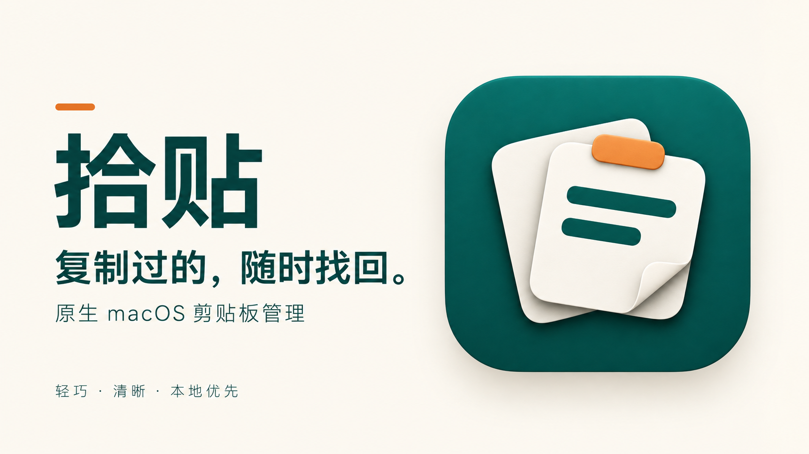
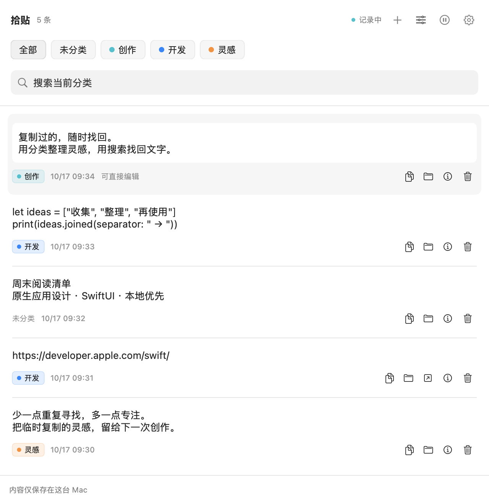
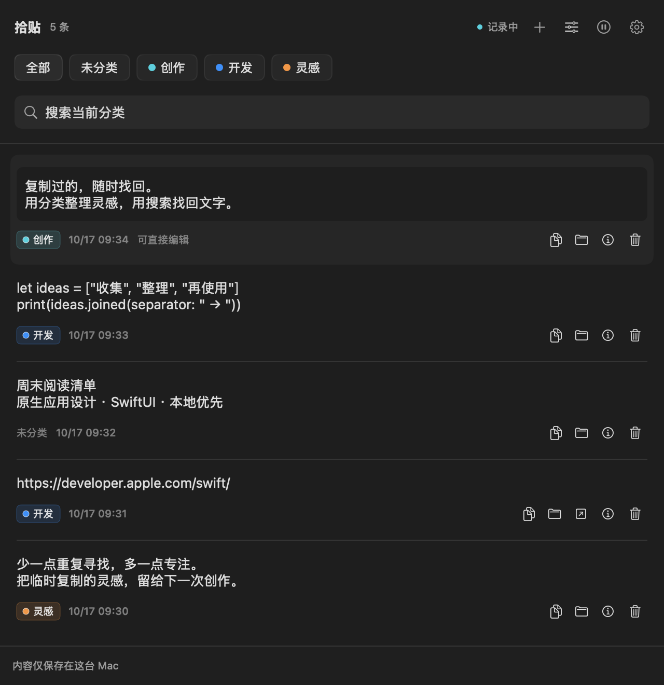

# ShiTie · 拾贴

**Keep what you copy. Find it when you need it.**

A native, local-first clipboard manager for macOS. Search your copied text, organize it with colored categories, and edit snippets in place.

[简体中文](README.md) · [Download](https://github.com/wangleijie5859/ShiTie/releases/latest) · [Detailed guide (Chinese)](docs/GUIDE.zh-CN.md) · [Report an issue](https://github.com/wangleijie5859/ShiTie/issues)

[](https://github.com/wangleijie5859/ShiTie/actions/workflows/ci.yml)
[](Package.swift)
[](Package.swift)
[](LICENSE)



## Features

- **Text and web links** — capture newly copied plain text and HTTP/HTTPS links. Exact duplicates move to the top and keep their category.
- **Search and organize** — custom categories in eight colors, with instant keyword search within the selected category.
- **Edit in place** — expand a record, change its text, then save or copy it. Unsaved drafts survive switching records within the current session.
- **Native macOS interface** — SwiftUI and AppKit, system light/dark appearance, keyboard navigation, and a menu bar presence after closing the window.
- **Local storage** — SQLite on your Mac. No account, cloud service, ads, telemetry, or third-party dependencies.
- **Recording controls** — pause/resume, configurable history capacity, and filtering for known sensitive clipboard markers.

The app interface is currently in Simplified Chinese. Source builds support Apple Silicon and Intel; the prebuilt download is for Apple Silicon.

## Preview

| Light | Dark |
| --- | --- |
|  |  |

Rendered from the actual interface using an isolated temporary database and synthetic sample content.

## Install

Requires **macOS 13 Ventura or later**.

Download `ShiTie-1.0.0-macOS-arm64.zip` from [Releases](https://github.com/wangleijie5859/ShiTie/releases/latest), unzip it, and move `拾贴.app` to Applications.

The initial binary is ad-hoc signed, without an Apple Developer ID signature or notarization. macOS may block the first launch. After checking the download source and checksum, use **System Settings → Privacy & Security → Open Anyway**, or build from source.

### Build from source

Install Xcode 15+ or Command Line Tools with Swift 5.9+, then run:

```sh
git clone https://github.com/wangleijie5859/ShiTie.git
cd ShiTie
./scripts/build-app.sh
open "dist/拾贴.app"
```

The script generates the icon, builds Release, packages the app, and signs it locally. No developer account is required. It builds for your current Mac's architecture. You can also open `Shitie.xcodeproj` in Xcode and run the `Shitie` scheme on My Mac.

## Use

1. Launch ShiTie, then copy text or a web link.
2. Search from the top bar, or assign a category using a record's folder button.
3. Click Copy to reuse it. Click the text to edit it in place and press `⌘S` to save.

| Shortcut | Action |
| --- | --- |
| `⌘F` | Search the current category |
| `⌘S` | Save changes to the selected record |
| `⇧⌘C` | Copy the selected record, saving edits first |
| `⇧⌘⌫` | Delete the selected record |
| `⇧⌘P` | Pause / resume recording |
| `⌘0` | Open the main window |
| `⌘,` | Open settings |

Shortcuts work while ShiTie is active; there is no global hotkey yet. Unsaved drafts stay in memory only. Save them before quitting.

## Privacy and limits

History lives at `~/Library/Application Support/Shitie/history.sqlite`. It is **not additionally encrypted**. Quit the app before backing up the entire `Shitie` data directory.

- No import of clipboard contents from before launch or while paused. Polling every 0.75 seconds may miss rapidly overwritten items.
- Default capacity: 1,000 records, evicting the least recently copied. Maximum text size: 1 MiB per item; oversized items are skipped without truncation.
- Images, files, and known sensitive clipboard markers are skipped. **Unmarked passwords cannot be reliably detected.** Pause before copying secrets.
- Plain text only. No image history, cloud sync, OCR, launch at login, or automatic pasting.

See the [detailed guide (Chinese)](docs/GUIDE.zh-CN.md) for storage, migration, and backup details. Report vulnerabilities using the [security policy](SECURITY.md).

## Develop and contribute

```sh
./scripts/test.sh       # 18 core checks + 5 editing-state checks
./scripts/build-app.sh  # Build, package, and sign locally
```

Tests use temporary databases and isolated named pasteboards. They do not modify your history or system clipboard. Pasteboard integration checks need access to a macOS login session.

| Path | Purpose |
| --- | --- |
| `Sources/Shitie/` | State coordination, SwiftUI interface, AppKit lifecycle |
| `Sources/ShitieCore/` | SQLite storage, models, pasteboard monitoring |
| `Tests/` | Core behavior and editing-state checks |
| `Resources/` | Artwork, icons, application metadata |
| `scripts/` | Build and test entry points |

Issues, feedback, translations, and pull requests are welcome. Read [CONTRIBUTING.md](CONTRIBUTING.md), browse the [roadmap](docs/ROADMAP.md), and see [validation notes (Chinese)](VALIDATION.md).

If ShiTie helps you recover something useful, consider giving it a **Star** or sharing how you use it.

## License

[MIT License](LICENSE) · Copyright © 2026 wangleijie5859
