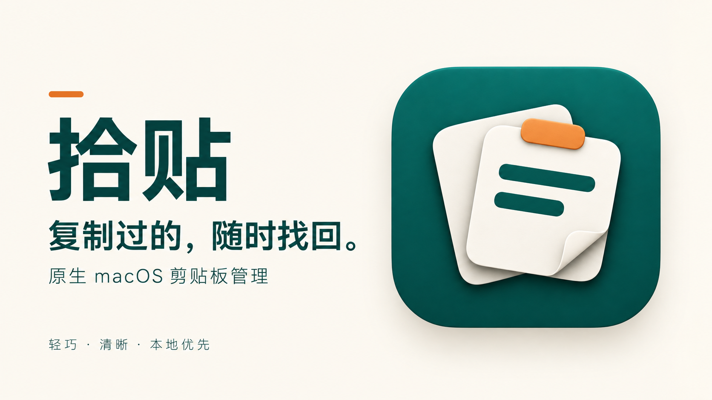
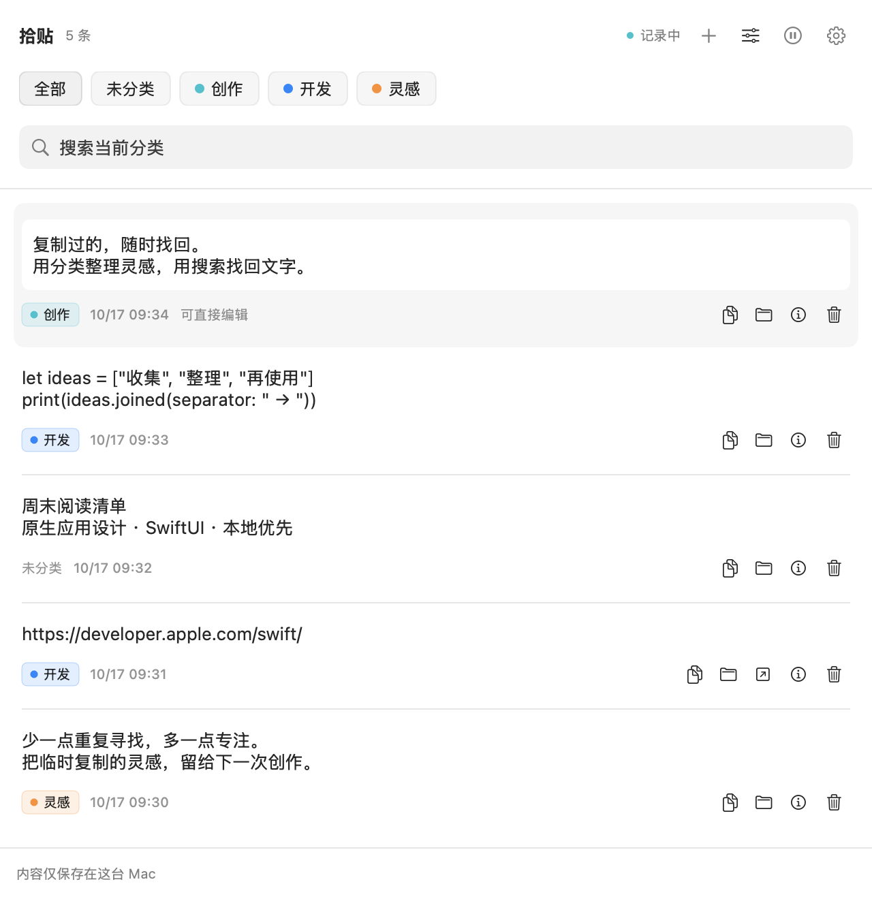
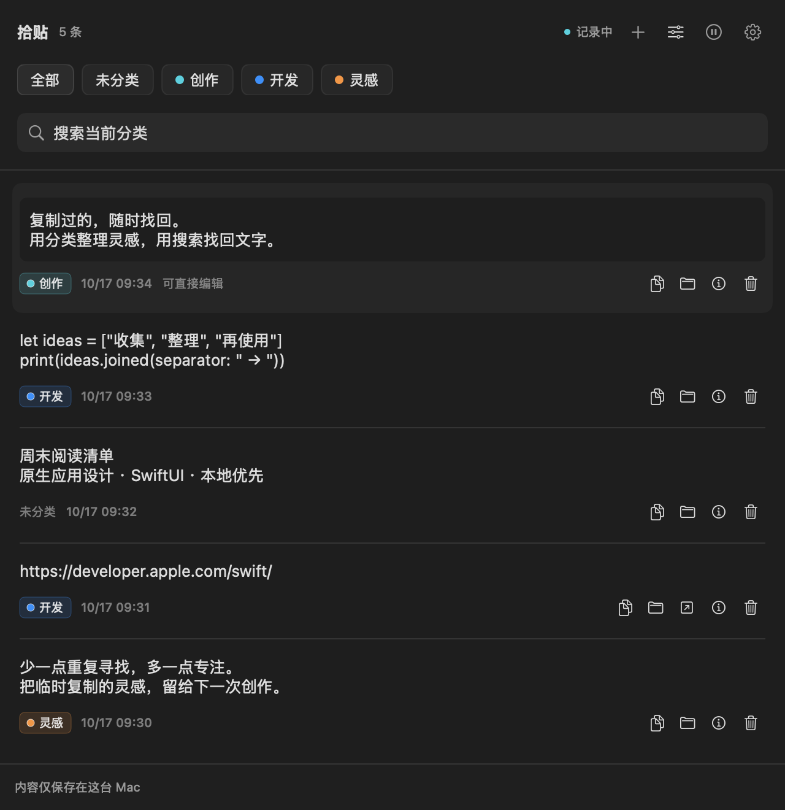

# 拾贴 · ShiTie

**复制过的，随时找回。**

一款本地优先的原生 macOS 剪贴板管理器，用分类、搜索和就地编辑，把复制过的文字重新用起来。

A native, local-first clipboard manager for macOS. Find, organize, and edit the text you copied.

[English](README.en.md) · [下载](https://github.com/wangleijie5859/ShiTie/releases/latest) · [使用指南](docs/GUIDE.zh-CN.md) · [反馈问题](https://github.com/wangleijie5859/ShiTie/issues)

[](https://github.com/wangleijie5859/ShiTie/actions/workflows/ci.yml)
[](Package.swift)
[](Package.swift)
[](LICENSE)



## 为日常复制准备

- **找回文字与链接**：自动保存新复制的纯文本与 HTTP/HTTPS 链接；相同内容置顶，保留原有分类。
- **按自己的方式整理**：自定义分类、8 种颜色、当前分类内即时搜索，支持中文、英文与 URL。
- **直接展开、编辑、再复制**：在记录内修改内容，支持保存和撤销本次修改；切换记录时保留未保存草稿。
- **一个简洁的原生窗口**：SwiftUI + AppKit，跟随系统深浅色；关闭窗口后继续在菜单栏运行。
- **数据留在 Mac 上**：SQLite 本地保存，无账号、云服务、广告或遥测，无第三方依赖。
- **控制记录范围**：随时暂停，设置历史数量上限，跳过带已知敏感标记的剪贴板内容。

当前应用界面为简体中文。支持 Apple Silicon 和 Intel 源码构建；现成下载包为 Apple Silicon 版本。

## 界面预览

| 浅色 | 深色 |
| --- | --- |
|  |  |

预览由项目真实界面渲染，使用独立临时数据库与虚构示例内容。

## 安装

### 下载应用

前往 [Releases](https://github.com/wangleijie5859/ShiTie/releases/latest)，下载 `ShiTie-1.0.0-macOS-arm64.zip`，解压后将 `拾贴.app` 拖入“应用程序”。需要 **macOS 13 Ventura 或更新系统**。

首发下载包使用 ad-hoc 签名，尚未进行 Apple Developer ID 签名或公证。macOS 可能阻止首次打开；确认下载来源和校验值后，可在“系统设置 → 隐私与安全性”中选择“仍要打开”。也可以按下面的步骤从源码构建。

### 从源码构建

安装 Xcode 15+ 或提供 Swift 5.9+ 的 Command Line Tools，在终端执行：

```sh
git clone https://github.com/wangleijie5859/ShiTie.git
cd ShiTie
./scripts/build-app.sh
open "dist/拾贴.app"
```

脚本自动生成应用图标、编译 Release、打包 `.app` 并执行本机签名，无需开发者账号。默认构建当前 Mac 的架构。也可使用 Xcode 打开 `Shitie.xcodeproj`，选择 `Shitie → My Mac → Run`。

## 上手只需三步

1. 打开拾贴后，复制一段文字或网页链接，新记录会自动出现在列表中。
2. 用顶部搜索框找回内容，或用记录下方的文件夹按钮归入分类。
3. 点击复制按钮重新使用；需要修改时点击正文展开，在原处编辑并按 `⌘S` 保存。

| 快捷键 | 操作 |
| --- | --- |
| `⌘F` | 搜索当前分类 |
| `⌘S` | 保存当前记录的修改 |
| `⇧⌘C` | 复制所选记录，有修改时先保存 |
| `⇧⌘⌫` | 删除所选记录 |
| `⇧⌘P` | 暂停 / 恢复记录 |
| `⌘0` | 打开主窗口 |
| `⌘,` | 打开设置 |

这些快捷键在拾贴内生效，暂不支持全局呼出。未保存的草稿仅在本次进程内保留，退出前请保存。

## 隐私与使用边界

历史保存在 `~/Library/Application Support/Shitie/history.sqlite`，数据库**未额外加密**。备份时先退出应用，再复制整个 `Shitie` 数据目录。

- 启动前和暂停期间的剪贴板不会补录；应用每 0.75 秒检查一次，可能错过被迅速覆盖的内容。
- 默认保留 1,000 条记录，超过容量后按最近复制时间清理旧记录；单条文本上限 1 MiB，超限不会截断保存。
- 跳过图片、文件和已知敏感标记，**无法可靠识别没有标记的密码**。复制密码、密钥等敏感内容前请暂停记录。
- 当前只保存纯文本；暂不提供图片历史、云同步、OCR、开机启动和自动粘贴。

完整规则、数据迁移和备份说明见 [使用指南](docs/GUIDE.zh-CN.md)。安全问题请按 [安全政策](SECURITY.md) 私下报告。

## 开发与贡献

```sh
./scripts/test.sh       # 18 项核心检查 + 5 项编辑状态检查
./scripts/build-app.sh  # 编译、打包并签名
```

测试使用临时数据库和独立命名剪贴板，不改动你的历史与系统剪贴板。剪贴板集成检查需要可连接 macOS 登录会话的环境。

| 目录 | 内容 |
| --- | --- |
| `Sources/Shitie/` | 应用状态、SwiftUI 界面、AppKit 生命周期 |
| `Sources/ShitieCore/` | SQLite 数据访问、数据模型、剪贴板监听 |
| `Tests/` | 核心行为与编辑状态检查 |
| `Resources/` | 图标、封面、应用元数据 |
| `scripts/` | 本地构建与测试入口 |

欢迎提交问题、体验建议、翻译或 PR；开始前可阅读 [贡献指南](CONTRIBUTING.md)。近期方向见 [路线图](docs/ROADMAP.md)，已有检查记录见 [VALIDATION.md](VALIDATION.md)。

如果拾贴帮你找回过有用的内容，欢迎点一个 **Star**，也欢迎分享你实际使用的场景。

## 许可证

[MIT License](LICENSE) · Copyright © 2026 wangleijie5859
