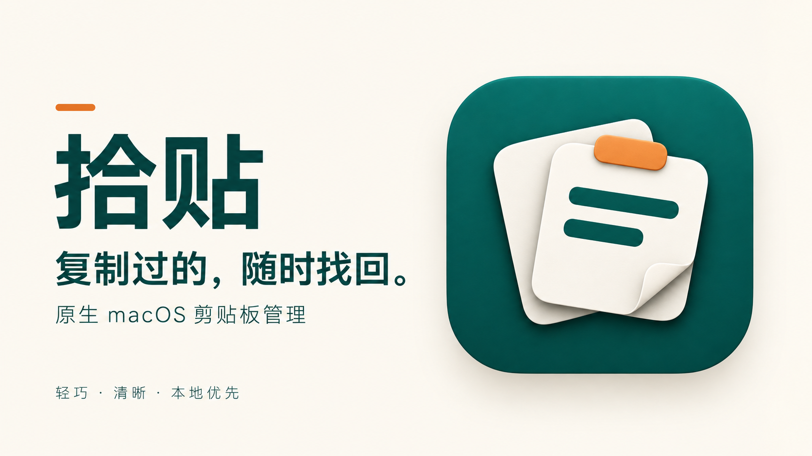

# 拾贴使用与实现指南

[返回项目首页](../README.md) · [English overview](../README.en.md)



原生 macOS 剪贴板管理应用。SwiftUI 单栏界面，AppKit 菜单栏与窗口管理，SQLite 本地持久化；没有第三方依赖、账号或联网服务。

## 启动

最低系统 **macOS 13 Ventura**。源码使用 Swift 5.9+，建议 Xcode 15+ 或对应 Command Line Tools。支持 Apple Silicon 和 Intel，脚本默认构建当前机器的架构。

构建完成后，可在 Finder 中双击 `dist/拾贴.app`，或在项目目录执行：

```sh
open "dist/拾贴.app"
```

从源码生成本地可运行版本（无需开发者账号）：

```sh
./scripts/build-app.sh
open "dist/拾贴.app"
```

脚本先将 `Resources/Brand/AppIcon.png` 转换为完整尺寸的 macOS 图标，再使用 Swift Package 编译 Release、打包并执行本机 ad-hoc 签名。构建缓存放在项目的 `.build` 内。Debug 构建用 `./scripts/build-app.sh debug`，包含仅用于验收的“调试 → 预览浅色/深色外观”菜单，Release 自动跟随系统。

有完整 Xcode 时打开 **Shitie.xcodeproj**，选择 **Shitie → My Mac → Run**。工程默认关闭开发者签名，方便本机调试；`Package.swift` 也可以直接打开。对外分发需要另行配置 Developer ID 签名及公证；首发下载包为 ad-hoc 签名的 Apple Silicon 版本，尚未公证。

## 已实现

- 每 0.75 秒检查剪贴板 `changeCount`，允许 0.2 秒计时容差，未变化时不读取内容。
- 保存纯文本、HTTP/HTTPS 网页链接；完全相同的 UTF-8 内容只更新时间与排序，保留原分类。
- 单栏记录列表，分类和搜索集中在顶部，默认窗口宽 640 点，最窄 560 点。点击记录后就地展开可滚动的完整内容，保留换行和缩进；点击记录外区域、顶部控件或切换到其他应用时自动收起，无需展开/收起图标。收起后后台刷新不会重新打开，未保存草稿保留。正文前没有类型图标。每条记录底部一行左侧是分类标签、最近复制时间，右侧直接显示复制、分类、信息、删除图标；链接另有浏览器打开图标。所有操作都有悬停提示和无障碍名称。
- 展开内容后直接修改，无需编辑图标或独立窗口。修改后就地出现保存（勾号）、取消（回转箭头）图标；点击复制会先保存再复制修改后的内容。保留原分类和首次记录时间，单独保存不改变最近复制时间。空白、超限、无效文本及与其他记录完全重复的修改会提示，保留原记录和编辑稿。
- 切换记录、分类、搜索或关闭主窗口时，未保存的草稿暂存在内存；底部提示未保存数量并可点击返回。即使原记录被容量清理，仍可回到草稿手动复制保留。退出时有未保存修改会提醒；草稿需保存后才能跨重启保留。
- 分类提供青、蓝、紫、粉、橙、绿、红、灰 8 种颜色。新分类优先使用尚未占用的颜色；顶部分类管理按钮或分类按钮右键菜单可编辑名称与颜色。颜色在顶部分类圆点与记录分类标识上同步显示，重启后保留，旧分类自动分配颜色。
- “全部 / 未分类”入口；自定义分类创建、重命名、删除；删除分类只解除归属。拒绝空名称、重复名称和系统保留名。
- 当前分类内即时关键词搜索，中文、英文大小写、URL 与 `%`、`_` 均按字面查找。
- 暂停 / 恢复；暂停期间及恢复之前的内容不会补录。启动前已有的剪贴板也不读取。
- 默认 1000 条容量，超出上限时按最近复制时间清理最旧的记录；所有记录使用同一规则，降低上限会立即执行清理。
- 清空历史前确认，清空全部记录与未保存修改，自定义分类保留。
- 菜单栏打开、暂停/恢复、设置、退出；关闭主窗口继续记录；重新打开使用原窗口，退出前等待已接受的写入完成。
- 跟随系统深浅色，原生控件、键盘导航、基本无障碍标签。
- 记录与顶部分类的选中背景使用中性灰色，窗口激活时也不显示蓝色选中底色；分类本身的颜色标识保留。灰色与文字颜色随系统深浅色自动适配。
- 展开区域采用更淡的灰色底，短文本按实际行数收紧，高度最多 180 点后滚动；编辑提示并入分类、时间与操作所在的一行，减少额外留白。超过 4 KiB 的长文本使用固定滚动区域，避免为测量高度排版整篇内容。

快捷键：`⌘F` 搜索、`⌘S` 保存所选记录的修改、`⇧⌘C` 复制所选记录（有修改时先保存）、`⇧⌘⌫` 删除所选记录、`⇧⌘P` 暂停/恢复、`⌘0` 打开主窗口、`⌘,` 设置、`⌘W` 关闭窗口、`⌘Q` 退出。编辑框支持标准复制、粘贴、撤销、全选；`⌘⌫` 保留原生删除到行首的行为。

## 数据与隐私

数据保存到：

```text
~/Library/Application Support/Shitie/history.sqlite
```

SQLite 使用 WAL、事务、外键和完整同步写入。新建数据目录权限为 `0700`。数据库读写、去重散列、搜索和批量清理在专用 actor 上执行，不占用主线程。列表仅载入最多 240 字的摘要，选中后才读取完整内容；详情使用支持按需布局的原生文本视图。

首次运行新版本会将格式 1、2 的旧数据库自动升级到格式 3，移除收藏状态，原有内容、分类、时间和设置保留，旧分类仍支持颜色。原来收藏的内容作为普通历史保留。升级本身不清理记录；若旧历史已超过上限，下一次采集内容或调整上限时按统一规则清理。旧版应用无法打开升级后的数据库。

备份时先退出拾贴，再复制整个 `Shitie` 数据目录。运行期间存在 `-wal` 和 `-shm` 配套文件，不要只复制主数据库。数据库不可用时不会创建空历史替代原文件；界面显示错误并提供重试。写入失败也会在界面提示，失败操作不会假装成功。

应用不会请求辅助功能、屏幕录制、通讯录或其他无关权限。打开链接是用户明确点击后的默认浏览器操作。应用不向其他软件自动粘贴、不记录内容到调试日志。

## 边界

- 单条上限 **1 MiB UTF-8**；超限整条跳过并提示，绝不静默截断。NUL 或非 UTF-8 内容会被拒绝。列表摘要不影响完整保存与复制。
- 只取纯文本表示，不保存富文本格式。带图片、文件类型的剪贴板整条跳过；仅有 RTF/HTML 而没有纯文本表示时不保存。
- 检测 `org.nspasteboard.ConcealedType`、`TransientType`、`AutoGeneratedType`、`de.petermaurer.TransientPasteboardType`、`PasswordPboardType` 及已知 `com.agilebits.onepassword` 类型。不会查询密码管理器；**没有敏感标记的密码无法可靠识别**，复制敏感信息前请暂停记录。
- 本机数据库未额外加密，建议结合 macOS 登录保护和 FileVault。删除是应用层删除，不承诺从 SSD、系统备份或 SQLite 历史页中做取证级擦除。
- 轮询会错过两次检查之间被迅速覆盖的内容；提供延迟数据的来源应用也可能造成短暂等待。应用退出、系统休眠期间不记录。
- 搜索使用 SQLite 字面子串匹配，英文忽略 ASCII 大小写，不含分词、拼音、模糊匹配。大量超长内容的搜索在后台进行，但可能有等待。
- 没有图片/文件历史、云同步、全局快捷键、开机启动、OCR、标签或自动粘贴。

## 构建与测试

```sh
./scripts/test.sh
./scripts/build-app.sh
```

测试使用可执行的 Swift 检查套件 `ShitieChecks`，无需 XCTest，适配仅有 Command Line Tools 的机器；任何失败返回非零退出码。临时数据库和独立命名的测试剪贴板不会改动用户的历史或系统剪贴板。剪贴板集成测试需要能连接当前登录会话的 macOS pasteboard 服务；隔离执行沙箱可能阻止连接，此时应在本机终端运行。

18 项关键检查覆盖：字节精确去重与排序、元信息保留、分类验证与删除、跨数据库连接持久化、中英文与 URL 搜索范围、统一容量清理、清空全部历史并保留分类、暂停、长度边界、链接识别、敏感类型跳过、自身复制抑制、实际计时器、数据库打开失败、事务回滚与更新版本数据保护，以及编辑后去重与类型更新、无效编辑保护、分类颜色持久化、格式 1/2 升级及失败回滚。

另有 5 项内联编辑状态检查，直接编译应用模型并注入临时数据库和独立剪贴板，验证收起后刷新不再展开且保留草稿、切换后保留草稿、取消与失败保护、保存并复制，以及原记录被清理后的草稿保留。

验收记录见 [VALIDATION.md](../VALIDATION.md)。首次本地验收环境仅有 Command Line Tools；Xcode 工程的 IDE 构建结果以 GitHub Actions 和后续验收记录为准。

## 结构

```text
Sources/ShitieCore/   SQLite 数据访问、数据类型、剪贴板监听
Sources/Shitie/       状态协调、SwiftUI 界面、AppKit 应用生命周期
Tests/ShitieCoreTests/ 可执行规则和剪贴板集成检查
Resources/           应用 Info.plist
scripts/             本地构建与测试入口
Shitie.xcodeproj/     无需外部生成器的 Xcode 工程
```
